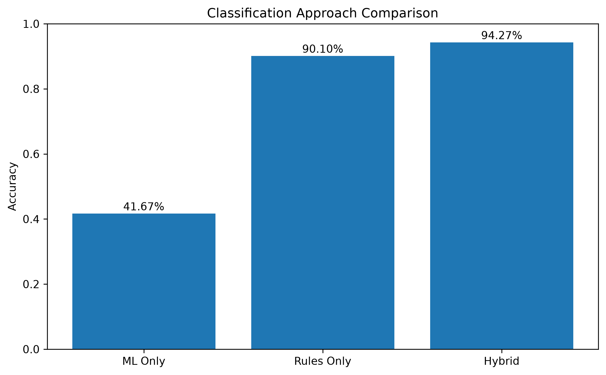
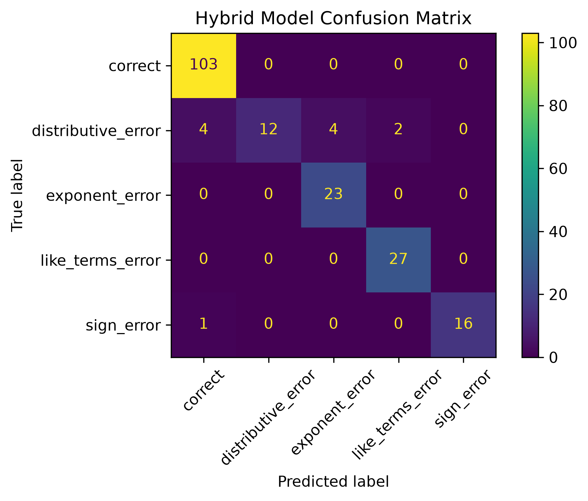
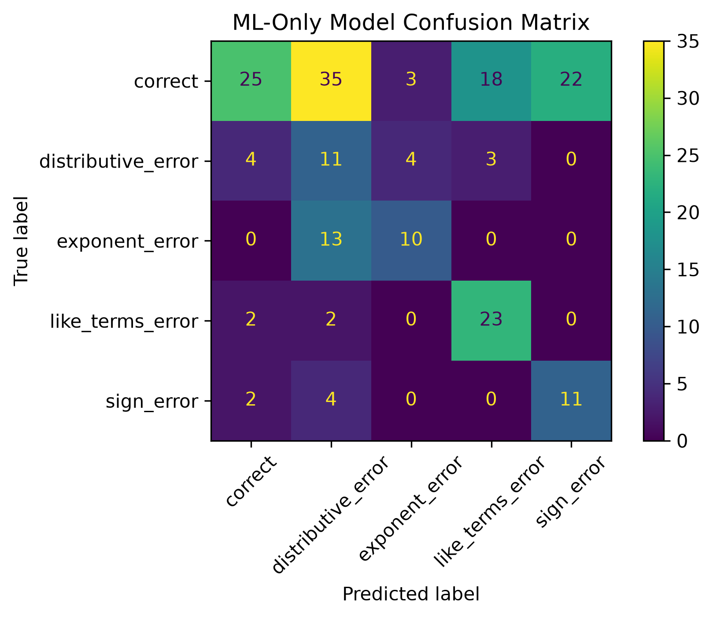

# AI-Powered Student Misconception Detection

A hybrid rule-based and machine-learning system for identifying common misconceptions in student responses to algebra problems.

The system combines deterministic mathematical rules with a TF-IDF and Logistic Regression classifier. Known misconception patterns are handled by high-precision rules, while machine learning acts as a fallback for responses that are not recognized by the rule system.

## Overview

Students can arrive at incorrect algebra answers for very different reasons. Simply marking an answer as incorrect does not explain the underlying misconception.

This project explores automatic classification of student responses into five categories:

- `correct`
- `distributive_error`
- `exponent_error`
- `like_terms_error`
- `sign_error`

For example:

```text
Problem: 6(x+4)
Student Answer: 6x

Classification: distributive_error
Feedback: Check the distributive property. Multiply the coefficient
by every term inside the parentheses.
```

The project also includes an interactive command-line demo that provides feedback based on the detected misconception.

---

## Hybrid Architecture

The classifier uses a three-stage prediction pipeline:

```text
Student Problem + Answer
          |
          v
+-----------------------+
|  Correctness Check    |
+-----------------------+
          |
          v
+-----------------------+
| Misconception Rules   |
+-----------------------+
          |
          v
    Rule matched?
      /       \
    Yes        No
     |          |
     v          v
 Rule Label   TF-IDF
               +
         Logistic Regression
               |
               v
           ML Label
```

### 1. Correctness Checking

The system first determines whether the student's answer is correct for one of the supported algebra problem formats.

### 2. Rule-Based Misconception Detection

Incorrect responses are checked against patterns representing known misconceptions involving:

- the distributive property
- negative signs
- combining like terms
- exponent rules

### 3. Machine-Learning Fallback

If no deterministic rule recognizes the response, the problem and student answer are converted into TF-IDF features and classified using Logistic Regression.

This design allows predictable misconception patterns to be handled explicitly while retaining a fallback for responses outside the rule system.

---

## Experimental Results

Three approaches were evaluated on the same 192-example synthetic test set:

| Approach | Accuracy |
|---|---:|
| ML Only | 41.67% |
| Rules Only | 90.10% |
| Hybrid Rules + ML | **94.27%** |

The rule system recognized 173 of 192 test examples, giving it **90.10% coverage**. On examples where a rule matched, its classification accuracy was **100%**.

The hybrid system improved overall accuracy by:

- **52.60 percentage points** over the ML-only baseline
- **4.17 percentage points** over the rules-only system

These results suggest that, within this controlled synthetic dataset, deterministic rules are effective for well-defined misconception patterns while the ML fallback provides additional coverage when no rule matches.

### Model Comparison



### Hybrid Confusion Matrix



### ML-Only Confusion Matrix



---

## Dataset

The project uses a procedurally generated synthetic dataset of algebra problems and student responses.

The generator creates examples involving:

- distribution
- combining like terms
- sign handling
- exponent multiplication

Each problem category contains both correct answers and simulated misconception patterns.

Using a fixed random seed makes dataset generation and evaluation reproducible.

The generated dataset contains:

```text
Training samples: 768
Testing samples:  192
Total samples:    960
```

The dataset can be regenerated using:

```bash
python src/generate_dataset.py
```

---

## Interactive Demo

Run the command-line demo with:

```bash
python src/demo.py
```

The program will train the classifier and then accept algebra problems and student answers interactively.

Example:

```text
AI Student Misconception Detector
=======================================================

Enter an algebra problem (or 'quit' to exit): 3x+3x
Enter the student's answer: 9x

Classification: like_terms_error
Feedback: Check how the like terms were combined. Add or subtract
their coefficients while keeping the variable and exponent unchanged.
```

### Supported Problem Formats

Current examples include:

```text
Distribution:  4(x+3)
Like terms:    3x+2x
Sign errors:   8-(-4)
Exponents:     x*x
```

---

## Running the Evaluation

Install the required dependencies:

```bash
pip install -r requirements.txt
```

Generate the dataset if necessary:

```bash
python src/generate_dataset.py
```

Run the full evaluation:

```bash
python src/train_model.py
```

The evaluation compares:

1. rule-only classification
2. ML-only classification
3. hybrid rule + ML classification

It also generates the evaluation figures in the `results/` directory.

---

## Project Structure

```text
.
├── data/
│   ├── train.csv
│   └── test.csv
│
├── results/
│   ├── hybrid_confusion_matrix.png
│   ├── ml_confusion_matrix.png
│   └── model_comparison.png
│
├── src/
│   ├── demo.py
│   ├── generate_dataset.py
│   ├── rules.py
│   └── train_model.py
│
├── .gitignore
├── README.md
└── requirements.txt
```

---

## Technologies

- Python
- pandas
- scikit-learn
- TF-IDF
- Logistic Regression
- Matplotlib

---

## Design Motivation

A purely statistical text classifier can learn correlations between problem/answer strings and misconception labels, but algebra contains structured relationships that are difficult to represent using simple text features alone.

A purely rule-based system can precisely recognize known patterns, but it cannot classify responses that fall outside those rules.

The hybrid architecture was designed to combine these strengths:

```text
Rules -> precision on known patterns
ML    -> fallback for unmatched responses
```

The evaluation reflects this behavior. The rules-only system achieved high accuracy but did not cover the entire test set, while the ML fallback increased the overall coverage and performance of the hybrid system.

---

## Limitations

This project is an experimental prototype rather than a production tutoring system.

The current implementation has several important limitations:

- The dataset is synthetic rather than collected from real students.
- Only a small set of algebra problem structures is supported.
- The misconception rules depend on predefined response patterns.
- TF-IDF represents expressions as text rather than understanding their symbolic mathematical structure.
- The current train/test split contains repeated problem structures and should not be interpreted as evidence of generalization to arbitrary unseen algebra problems.
- The exponent category currently uses a particularly limited problem structure.
- Inputs outside the supported problem formats may still receive a classifier label even when the system has insufficient information to make a meaningful diagnosis.

Because of these limitations, the reported **94.27% accuracy applies specifically to the project's controlled synthetic evaluation dataset**.

---

## Future Work

Potential improvements include:

- testing on real anonymized student-response data
- evaluating on completely unseen problem structures
- adding symbolic mathematics with tools such as SymPy
- expanding the number of misconception categories
- improving confidence handling for unsupported inputs
- replacing text-only features with mathematical expression representations
- adding probability or confidence estimates
- expanding feedback beyond fixed messages
- developing a graphical or web-based interface
- comparing additional machine-learning models
- adding automated unit and integration tests

A larger version of the system could use symbolic reasoning for mathematical correctness, deterministic rules for interpretable misconception detection, and learned models for more ambiguous student responses.

---

## Purpose

This project explores how interpretable rule-based reasoning and machine learning can complement one another in an educational AI application.

Rather than treating every incorrect answer as equivalent, the system attempts to identify the type of reasoning error behind a student's response and provide feedback appropriate to that misconception.